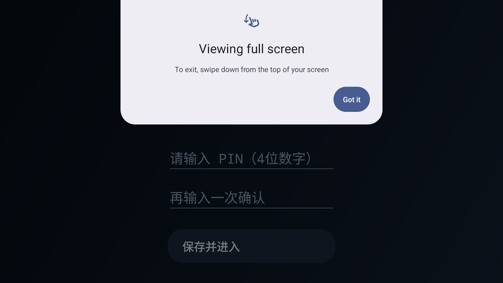
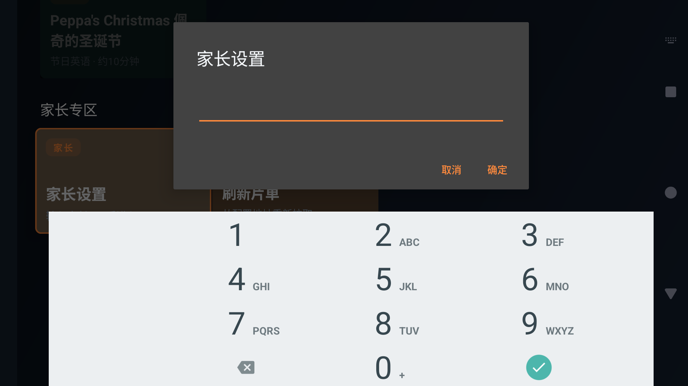

# 骁骁TV · EvoKids（Android TV）

给小学生二~三年级孩子的B站英语动画/纪录片**白名单播放器**：孩子在电视上**只能**看到家长通过服务器配置的片单，没有搜索、没有推荐、没有任意视频入口；家长用手机扫码登录B站账号后，应用内直接拉流播放。

- 📺 适配 Android TV / 65寸大屏（Leanback TV UI，D-pad遥控操作）
- 🔐 家长PIN锁：进入设置、退出应用均需验证；孩子按返回键无法退出
- 🌐 三级配置来源：**应用内配置的地址** → 内置默认远程地址 → 离线内置片单
- 📱 B站官方扫码登录（手机App扫码，电视端自动完成）
- ▶️ 直接播放：配置/搜索解析BV号 → B站html5接口取MP4直链 → ExoPlayer

## 项目结构

```
├── app/                    # Android TV 应用（Kotlin）
│   └── src/main/assets/config.default.json   # 离线兜底片单（365部）
├── docs/
│   ├── DESIGN.md           # 设计分析（架构/接口/决策）
│   ├── PLAN.md             # 执行方案
│   └── 365-english-kids-videos.md  # 365部片单文档
├── server/
│   ├── config.default.json # 片单母本（搜索词）
│   ├── config.json         # 已解析BV号的部署版
│   └── README.md           # 配置服务器部署说明
└── scripts/
    ├── resolve-bvids.js    # 调B站搜索接口解析BV号
    └── gen-md.js           # 由config.json生成片单MD
```

## 构建 APK

```bash
# 需要 JDK17 + Android SDK (platforms;android-35)
gradle assembleDebug
# 产物: app/build/outputs/apk/debug/app-debug.apk
```

或直接推送到 GitHub，用内置的 Actions（`.github/workflows/android-build.yml`）自动出APK。

安装到电视：

```bash
adb connect <电视IP>:5555
adb install -r app/build/outputs/apk/debug/app-debug.apk
```

> 国内电视盒子若装不上（签名/系统限制），可用电视自带的"U盘安装"。

## 界面实拍（Android 15 模拟器 · 1920×1080）

| 首启PIN向导 | 主界面 · 52周片单 |
|---|---|
|  |  |

| 焦点卡片 | 详情页 |
|---|---|
|  |  |

| 播放中 | 家长PIN门禁 |
|---|---|
|  |  |

| 家长设置 | 扫码登录 |
|---|---|
|  |  |

## 首次使用（家长做一次）

1. 启动App → 设置4位**家长PIN**；
2. `家长专区 → 家长设置`（输PIN）→ `扫码登录B站`：手机哔哩哔哩App扫码确认；
3. （可选）`修改配置地址`：填入你部署的 `server/config.json` 地址（见 `server/README.md`）；
4. 把遥控器交给孩子。

## 日常使用（孩子）

- 左侧选周主题（52周×7部），右侧选片 → `▶ 播放`；
- 播完自动连播下一部（可在配置里关掉 `play.autoplay_next`）；
- 想退出应用 / 进设置 / 跳转B站官方App → 全部需要家长PIN。

## 配置格式

见 `docs/DESIGN.md` 第4节。核心字段：

```jsonc
{ "id": "d001", "t": "Muddy Puddles 踩泥坑",
  "kw": "小猪佩奇 英文版 第1季 Muddy Puddles",  // BV号失效时的兜底搜索词
  "bvid": "BV1xx...",   // 可选
  "ep": 1,              // 选集P数
  "min": 5, "tag": "英语启蒙" }
```

## 已知限制

- 播放走B站网页端公开接口（html5直链，最高720p）；大会员高清番剧不在本片单范围；
- 视频若被下架，应用自动回退到"搜索词匹配"，仍失败则提示家长；
- 本应用仅供家庭自用，请遵守B站用户协议，勿商用分发。
