# 骁骁TV · EvoKids（Android TV）

给小学生的B站英语动画/纪录片**白名单播放器**：孩子在电视上**只能**看到家长通过服务器配置的片单，没有站内搜索、没有推荐、没有任意视频入口；家长用手机扫码登录B站账号后，应用内直接拉流播放（登录后**1080P高清 + 英中双语字幕**）。

- 📺 适配 Android TV / 65寸大屏（Leanback TV UI，D-pad遥控操作）
- 📚 **1000+部素材，按难度分级**：L1 启蒙 → L5 挑战 从易到难，左侧入口即等级，卡片带 L1-L5 徽标；另有纪录片专区
- 🔍 **白名单内搜索**：右侧顶部搜索卡，支持中文 / 英文 / 拼音（`peiqi`→小猪佩奇）甚至等级（`L1`），只在片单范围内
- 💬 **英中双语字幕**：优先B站CC字幕轨（上方英文大字、下方中文小字，AI轨需扫码登录）；**完全没有字幕轨的视频自动启用Vosk离线实时英文识别**（设备端41MB模型，无需联网）
- 🌐 三级配置来源：**应用内配置的地址** → 内置默认远程地址 → 离线内置片单
- 📱 B站官方扫码登录（手机App扫码，电视端自动完成），免PIN直达、返回键直接退出
- ▶️ 登录后走DASH音视频流（最高1080P，起播提示画质）；失败自动降级MP4直链 → ExoPlayer

## 项目结构

```
├── app/                    # Android TV 应用（Kotlin）
│   └── src/main/assets/config.default.json   # 离线兜底片单（365部）
├── docs/
│   ├── DESIGN.md           # 设计分析（架构/接口/决策）
│   ├── PLAN.md             # 执行方案
│   └── 365-english-kids-videos.md  # 365部片单文档
├── server/
│   ├── config.default.json # 片单母本（搜索词）
│   ├── config.json         # 已解析BV号的部署版
│   └── README.md           # 配置服务器部署说明
└── scripts/
    ├── resolve-bvids.js    # 调B站搜索接口解析BV号
    ├── fetch-covers.js     # 调B站详情接口抓封面图URL（卡片背景）
    └── gen-md.js           # 由config.json生成片单MD
```

## 构建 APK

```bash
# 需要 JDK17 + Android SDK (platforms;android-35)
gradle assembleDebug
# 产物: app/build/outputs/apk/debug/app-debug.apk
```

或直接推送到 GitHub，用内置的 Actions（`.github/workflows/android-build.yml`）自动出APK。

安装到电视：

```bash
adb connect <电视IP>:5555
adb install -r app/build/outputs/apk/debug/app-debug.apk
```

> 国内电视盒子若装不上（签名/系统限制），可用电视自带的"U盘安装"。

## 界面实拍（Android 15 模拟器 · 1920×1080）

| 主界面 · 全部影片 | 卡片焦点 |
|---|---|
| 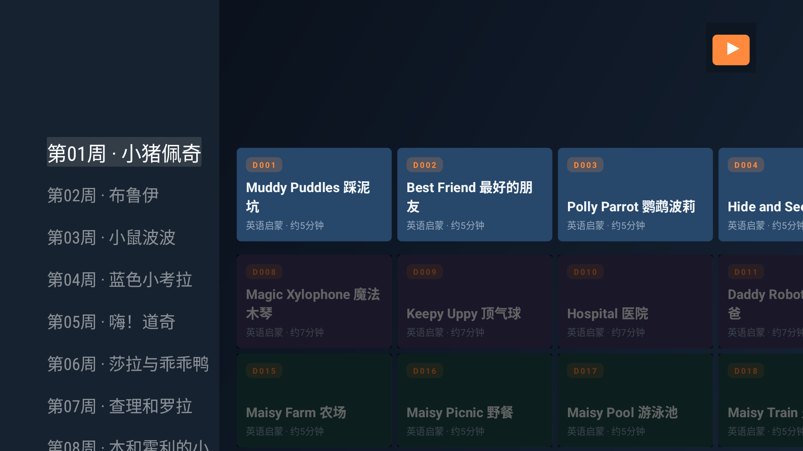 | 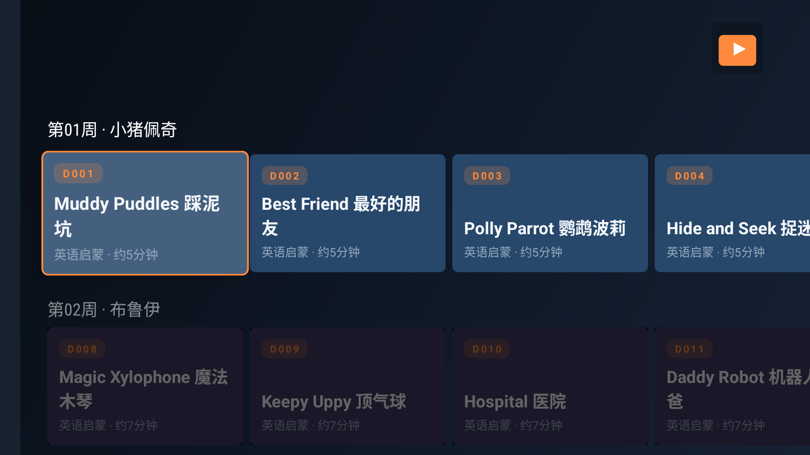 |

| 焦点卡片 | 详情页 |
|---|---|
|  | 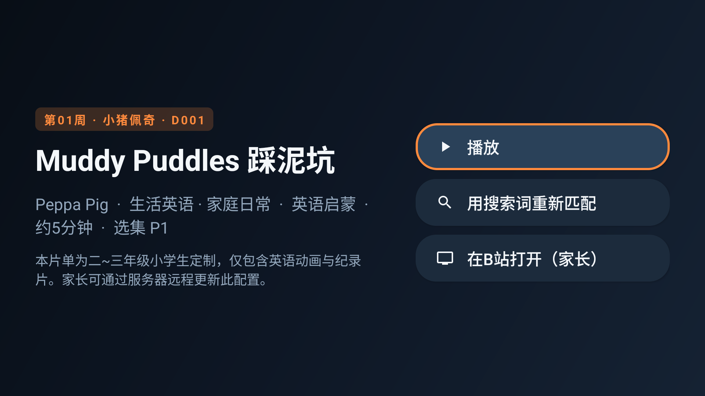 |

| 播放中 | 详情页 |
|---|---|
|  |  |

| 家长设置 | 扫码登录 |
|---|---|
| 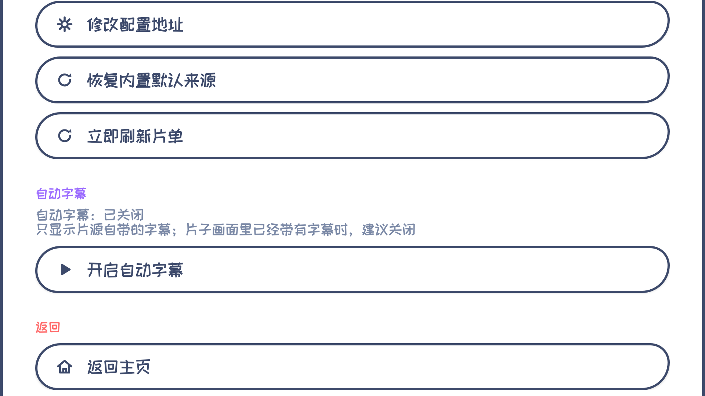 |  |

| 全部影片+等级分类 | L2 基础分类 | 按等级搜索(L1) |
|---|---|---|
| 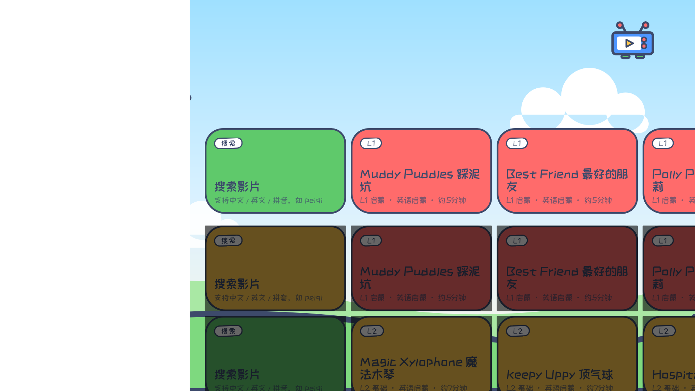 | 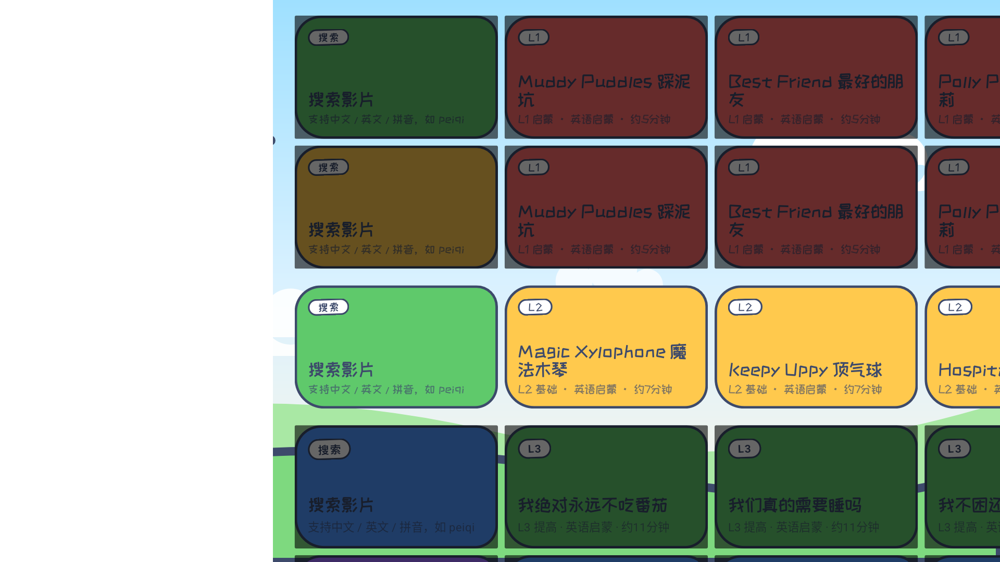 | 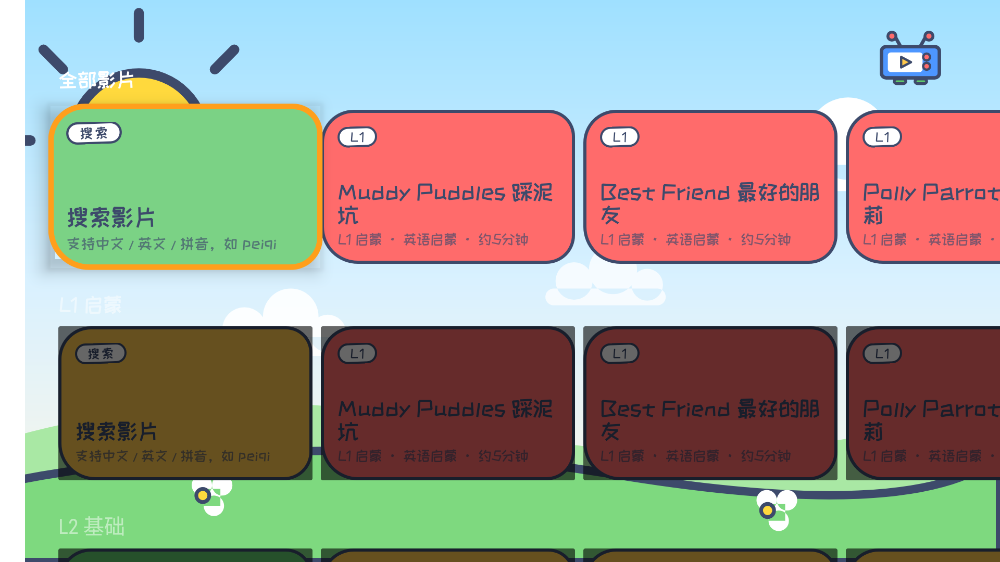 |

| 双语字幕（英文上/中文下） | Vosk实时英文识别（无字幕轨时） |
|---|---|
| 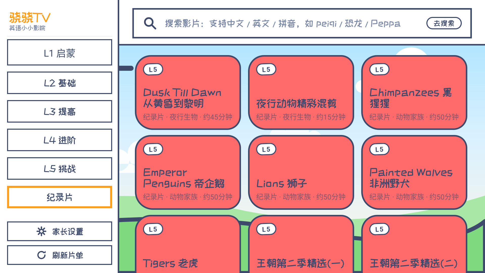 | 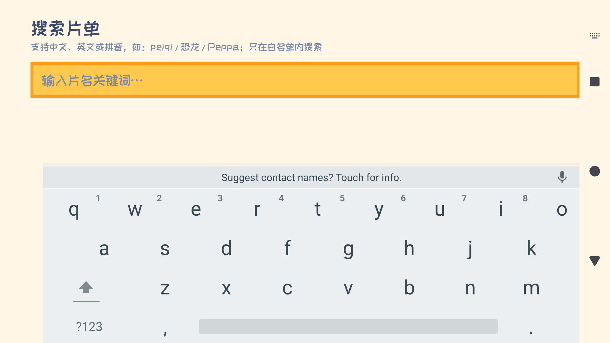 |

| 封面图卡片（小孩看图识片） | 封面卡片 · 焦点态 |
|---|---|
| 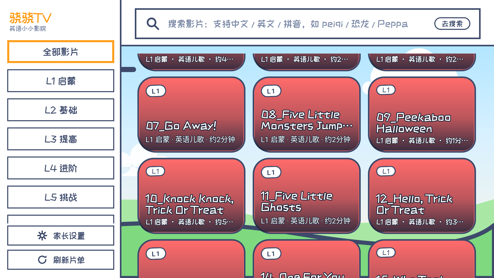 | 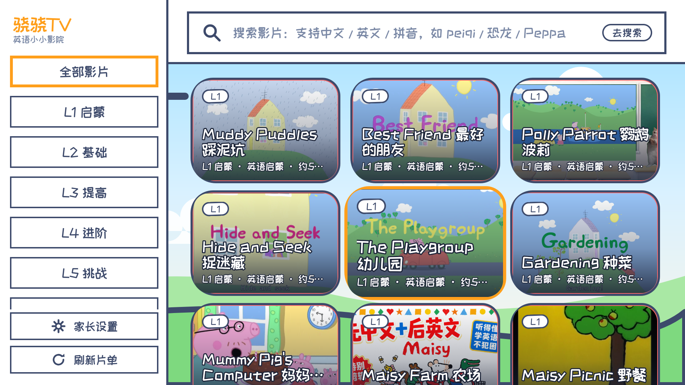 |

## 首次使用（家长做一次）

1. 启动App直接进入主界面（无PIN，返回键直接退出）；
2. `家长专区 → 家长设置` → `扫码登录B站`：手机哔哩哔哩App扫码确认（解锁1080P高清与双语字幕）；
3. （可选）`修改配置地址`：填入你部署的 `server/config.json` 地址（见 `server/README.md`）；
4. 把遥控器交给孩子。

## 日常使用（孩子）

- 左侧按难度选等级（L1启蒙~L5挑战 / 纪录片），右侧上方搜索卡可按片名 / 拼音 / 等级（如L1）搜索；
- 卡片左上角 L1-L5 徽标即难度等级，从易到难循序渐进；
- 播完自动连播下一部（可在配置里关掉 `play.autoplay_next`）。

## 配置格式

见 `docs/DESIGN.md` 第4节。v2 核心字段：

```jsonc
// categories 按难度等级组织（L1启蒙~L5挑战 + 纪录片），共 1041 部
{ "id": "n001", "t": "Muddy Puddles",
  "kw": "小猪佩奇 英文版 第1季 Muddy Puddles 1",  // BV号失效时的兜底搜索词
  "bvid": "BV1xx...", "ep": 1,      // BV号 + 选集P数（合集按分P展开）
  "min": 5, "tag": "英语启蒙",
  "cover": "https://i0.hdslb.com/...",  // 封面图URL（卡片背景，scripts/fetch-covers.js生成）
  "lv": 1 }                          // 难度等级1-5，卡片徽标与分类入口
```

## 已知限制

- 未登录时走B站网页端公开接口（html5直链，约480P）；**扫码登录后**走DASH流（普通账号最高1080P，大会员账号可到4K）；
- 双语字幕依赖B站CC/AI字幕轨（登录后自动拉取，英文上/中文下）；无字幕轨的视频不显示外挂字幕；
- 大会员专享高清番剧不在本片单范围；
- 视频若被下架，应用自动回退到"搜索词匹配"，仍失败则提示家长；
- 本应用仅供家庭自用，请遵守B站用户协议，勿商用分发。
